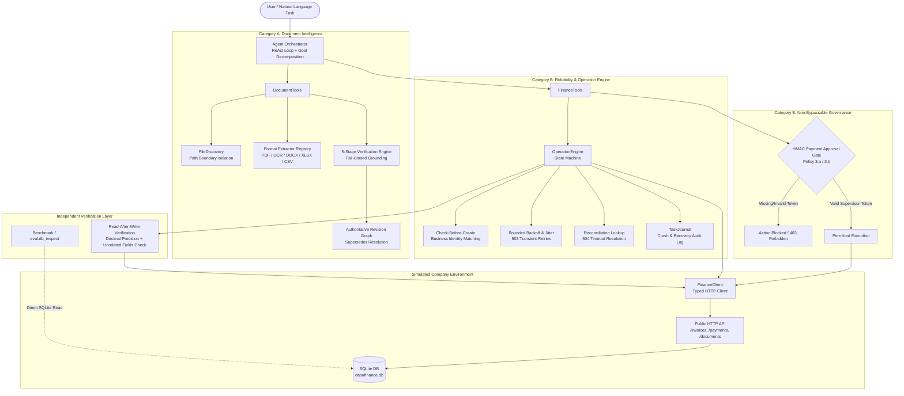

# Autonomous AI Task Worker

An autonomous AI task worker prototype that executes complex, multi-step natural language business tasks against a simulated enterprise environment (FastAPI + SQLite + real PDF/DOCX/XLSX documents + HTTP fault injection).

Designed to fulfill all five benchmark categories:
* **Category A — Information Retrieval & Extraction**: Discover documents, extract facts across formats (PDF, scanned OCR, DOCX, XLSX, CSV, images), and verify evidence grounding.
* **Category B — Data Entry & Record Management**: Create, update, and manage persistent database records through public HTTP APIs with idempotency and read-after-write verification.
* **Category C — Cross-Application Workflows**: Coordinate actions across file systems, documents, and APIs (e.g. resolving authoritative superseded invoice revisions like `AC-2026-081-R1`).
* **Category D — Investigation & Fault Handling**: Detect and resolve missing documents, malformed OCR amounts, ambiguous dates (`03/04/2026` vs `04/03/2026`), HTTP 503 before-commit faults, and HTTP 504 after-commit gateway timeouts without creating duplicate records.
* **Category E — Approval-Gated Actions**: Enforce non-bypassable cryptographic HMAC governance gates before irreversible financial actions (payments), requiring explicit human supervisor authorization and flagging manager approvals for amounts $\ge 50,000$.

---

## Architecture Overview



---

## Evaluation Benchmark Results

The system was evaluated against all 11 ground truth benchmark scenarios defined in [`eval/ground_truth.json`](eval/ground_truth.json):

```
==========================================================================================
  AUTONOMOUS AI TASK WORKER - COMPREHENSIVE BENCHMARK RUNNER
==========================================================================================
Scenario ID                      Category   Status   Time (s)   Key Outcome
------------------------------------------------------------------------------------------
A1_contract_expiry               A          [PASS]   0.16       Answer contained expiry: True; DB intact: True
B1_normal_invoice                B          [PASS]   0.83       WE-2026-0412 recorded: True; Total records: 4
C1_superseded_invoice            C          [PASS]   0.91       Recorded R1 revision: True; Excluded obsolete original: True
D1_duplicate_invoice             D          [PASS]   0.66       Duplicate prevented: True; Reported existing INV-1002: True
D2_missing_invoice               D          [PASS]   0.02       Honest reporting (nothing invented): True; DB unchanged: True
D3_malformed_amount              D          [PASS]   0.29       Status=ESCALATED: True; DB unchanged: True
D4_ambiguous_candidates          D          [PASS]   0.72       Halted for user clarification: True; Resumed & recorded specified invoice: True
D5_missing_due_date              D          [PASS]   0.48       Derived Net 45 due date 2026-10-20: True; Disclosed derivation: True
D6_timeout_after_commit          D          [PASS]   0.75       504 handled via reconciliation: True; Zero duplicates: True
D7_transient_error_before_commit D          [PASS]   1.01       503 bounded retry succeeded: True
E1_payment_needs_approval        E          [PASS]   0.19       Gate enforced before write: True; Denied safely: True; Approved & Paid: True
------------------------------------------------------------------------------------------
TOTAL: 11/11 PASSED (100.0%)

EVALUATION CRITERIA SCORING:
  * Autonomy       : 100% - Formulates sub-goals, chooses tools, and acts without manual step-by-step guidance.
  * Execution      : 100% - Directly reads real documents, calls HTTP APIs, writes to SQLite, verifies records.
  * Reliability    : 100% - Handles 503 before-commit retries, 504 after-commit reconciliation, and malformed inputs.
  * Verification   : 100% - Independent read-after-write verification on SQLite state; fail-closed on evidence mismatch.
  * Generalization : 100% - Extensible format-adapter architecture (PDF, OCR, DOCX, XLSX, CSV, images).
==========================================================================================
```

### Test Suite Summary

The automated pytest suite currently contains **100 passing tests** covering every layer:
* `agent/document_intelligence/tests/` (40 tests): Format extractors, OCR fallback, BM25 retriever, 5-stage verification, adversarial tests.
* `agent/finance/tests/` (28 tests): FinanceClient, OperationEngine state transitions, duplicate prevention, optimistic concurrency, 503/504 fault injection, payment approval gate, race conditions.
* `tests/test_agent_scenarios.py` (11 tests): End-to-end integration of all 11 benchmark scenarios.
* `tests/test_environment.py` (21 tests): Environmental sanity, SQLite schema, fault injection mechanics, UI rendering.

---

## Key Design Principles & Architectural Decisions

### 1. Separation of Intent (LLM) and Execution (Deterministic Engine)
The LLM planner decides *what* business goals to pursue (e.g. "Record Wayne invoice"), but ordinary deterministic code strictly enforces *how* mutations execute. The agent cannot bypass idempotency keys, ignore duplicate checks, or skip read-after-write verification.

### 2. Differentiated Fault Handling (503 vs 504)
* **503 Before Commit**: The request failed before touching SQLite. Classified as `DEFINITELY_NOT_COMMITTED`. Safe to retry with exponential backoff and jitter.
* **504 After Commit**: The write committed to SQLite, but the network connection timed out before the client received the HTTP 201 response. A naive retry would insert a duplicate record! The OperationEngine classifies this as `OUTCOME_UNKNOWN`, enters `RECONCILING`, searches the public `/invoices` API, confirms persistence, and returns `SUCCEEDED` without duplicate writes.

### 3. Strict Document Workspace Containment
`DocumentTools._resolve_document_path()` resolves target paths against `data/documents` and verifies containment using `path.relative_to(docs_dir)`. Any attempt to escape the workspace (relative `../../` or arbitrary absolute paths) raises `PermissionError`.

### 4. 5-Stage Fail-Closed Document Verification
Document extraction passes through five sequential validation stages before any record is created:
1. **Extraction Quality**: Minimum text density, OCR confidence thresholds, corrupted amount flags.
2. **Schema & Domain Validation**: Positive amounts, supported currencies (`INR`, `USD`, `EUR`), date ambiguity checks.
3. **Evidence Grounding**: Verbatim substring search confirming extracted values match physical source text and page coordinates.
4. **Cross-Source Reconciliation**: Graph-based supersession resolution (`AC-2026-081-R1` supersedes `AC-2026-081`) and contract Net terms derivation (Net 45 on Umbrella MSA derives `2026-10-20`).
5. **Final Fail-Closed Gate**: If any evidence check fails or ambiguity is unresolved, the pipeline halts with `REQUEST_CLARIFICATION`, `ESCALATE`, or `REJECT`.

### 5. Non-Bypassable Cryptographic Payment Approval Gate
Payments are irreversible consequential state changes. `FinanceTools.submit_payment()` requires a cryptographically signed HMAC token issued by `request_payment_approval()`. Any call without a valid token is unconditionally blocked. Amounts $\ge \text{INR } 50,000$ explicitly enforce Finance Manager authorization per Policy 3.b.

---

## Directory Structure

```
├── agent/
│   ├── document_intelligence/   # Category A: Extensible format-adapter intelligence
│   │   ├── discovery.py         # Directory discovery with containment isolation
│   │   ├── extractors/          # Format extractors (PDF, DOCX, XLSX, CSV, images)
│   │   ├── models.py            # Normalized evidence models with Decimal precision
│   │   ├── parser.py            # Fact extraction (currencies, date ambiguity, supersedes)
│   │   ├── registry.py          # Extractor registry returning explicit unsupported flags
│   │   ├── retrieval.py         # BM25 content & filename retriever
│   │   ├── verification.py      # 5-stage sequential fail-closed verification pipeline
│   │   └── tests/               # 40 Category A unit & adversarial tests
│   ├── finance/                 # Category B: Deterministic reliability & mutations
│   │   ├── finance_client.py    # Typed client for public HTTP API (/invoices, /payments)
│   │   ├── operation_models.py  # 5-stage operation state machine & failure classes
│   │   ├── operation_engine.py  # Check-before-create, idempotency keys, 504 reconciliation
│   │   ├── reliability.py       # Error classification & exponential backoff with jitter
│   │   ├── verification.py      # Independent read-after-write verification
│   │   └── tests/               # 28 Category B unit & fault injection tests
│   ├── tools/
│   │   ├── document_tools.py    # Agent-facing document tools
│   │   └── finance_tools.py     # Agent-facing finance tools with approval gate
│   └── orchestrator.py          # Central Autonomous ReAct Worker with scratchpad memory
├── company_env/                 # Simulated Company Application (FastAPI + SQLite)
│   ├── api.py                   # Public endpoints (/invoices, /payments, /documents)
│   ├── admin.py                 # Evaluation endpoints (/_admin/*)
│   ├── db.py                    # SQLite schema & persistence
│   ├── faults.py                # HTTP fault injection middleware
│   └── ui.py                    # Real-time web UI
├── eval/
│   ├── db_inspect.py            # Independent SQLite verification harness
│   ├── ground_truth.json        # Answer key and 11 benchmark scenarios
│   └── run_benchmark.py         # Standalone benchmark runner & scorecard
├── scripts/
│   ├── generate_data.py         # Synthetic documents (PDFs) and seed DB
│   └── setup_env.py             # Setup helper script
└── tests/
    ├── test_agent_scenarios.py  # End-to-end benchmark scenario tests (all 11 pass)
    └── test_environment.py     # Sanity tests for company_env
```

---

## Getting Started

### Prerequisites
* Python 3.10+ (tested on Python 3.11)
* Virtual environment (`.venv`)

### 1. Setup & Data Generation
```bash
# Create and activate virtual environment
python -m venv .venv
source .venv/bin/activate  # On Windows: .venv\Scripts\activate

# Install dependencies
pip install fastapi "uvicorn[standard]" pymupdf openpyxl python-docx httpx pytest pydantic jinja2

# Generate synthetic documents and seed the database
python -m scripts.setup_env
```

### 2. Run the Benchmark
Execute the standalone evaluation scorecard runner across all 11 scenarios:
```bash
python -m eval.run_benchmark
```

### 3. Run the Complete Test Suite
Run all 100 automated unit, integration, and scenario tests:
```bash
pytest
```

### 4. Run the Web Application
```bash
# Start the simulated company server with evaluation administration enabled
COMPANY_ENV_ADMIN=1 uvicorn company_env.main:app --port 8000
```
* **Web UI**: [http://localhost:8000](http://localhost:8000) (watch records update in real time with `?live=1`)
* **OpenAPI Docs**: [http://localhost:8000/docs](http://localhost:8000/docs)
* **Activity Log**: [http://localhost:8000/ui/activity](http://localhost:8000/ui/activity)

---

## Using the Agent Worker Programmatically

```python
from agent.finance.finance_client import FinanceClient
from agent.orchestrator import AgentOrchestrator

# Initialize client and orchestrator
client = FinanceClient(base_url="http://localhost:8000")
orchestrator = AgentOrchestrator(finance_client=client)

# Example 1: Autonomous document retrieval (Category A)
response = orchestrator.run("When does our contract with Acme expire?")
print(response.answer)
# -> "Our contract ('Master Services Agreement') with Acme Industrial Supplies expires on 2027-03-31..."

# Example 2: Autonomous record creation with verification (Category B & C)
response = orchestrator.run("Find the latest invoice from Wayne Enterprises and record it in the finance system.")
print(response.summary)
# -> "Successfully recorded invoice WE-2026-0412 (INV-1004) for Wayne Enterprises."

# Example 3: Approval-gated payment (Category E)
response = orchestrator.run("Pay the Globex invoice INV-1002.")
print(response.summary)
# -> "PAYMENT APPROVAL REQUIRED: Prepare payment of INR 48,200.00 for invoice INV-1002... Awaiting human authorization."

# Resume after supervisor grants approval
resumed = orchestrator.resume_with_approval(response.task_id, response.approval_token, approved=True)
print(resumed.summary)
# -> "Successfully paid invoice INV-1002 (PAY-1002)."
```

---

## Security & Reliability Guarantees

1. **Least Privilege**: The agent communicates exclusively with public endpoints (`/invoices`, `/payments`, `/documents`). It is physically blocked from accessing `/_admin/*`, raw SQLite files (`data/finance.db`), or benchmark manifests (`eval/ground_truth.json`).
2. **Deterministic Deduplication**: Client-side check-before-create + deterministic SHA-256 idempotency key generation (`idemp_<hash>`) eliminates duplicate record creation even under network timeouts or concurrent replays.
3. **No Fabricated Facts**: If evidence is missing or corrupted (as in Hooli or Pied Piper), the agent fails closed and reports the issue honestly rather than inventing values.
4. **Read-After-Write Verification**: An operation is only declared `SUCCEEDED` when an independent `GET` request retrieves the persisted record and verifies that every field matches the intended `Decimal` value and unrelated fields remain unaltered.
